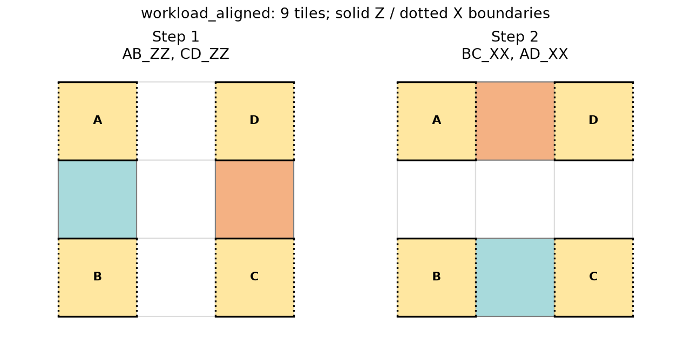

# Surface-code layout optimization: explanation, results, and trade-offs

This document explains the challenge, the repository's implementation, both
optimization passes, the measured results, and how to present them.

## 1. The project in one paragraph

The project asks how to perform a fixed sequence of joint quantum measurements
using less board space and fewer logical time steps. It represents four logical
qubits as patches on a rectangular grid, finds auxiliary paths between their
boundaries, and schedules compatible measurements together. The best tested
placement completes four measurements using **9 tiles and 2 steps**, giving
**18 tile-steps**, compared with the original compact layout's 60 tile-steps.
The Python implementation was also optimized independently to compute routes,
schedule operations, validate results, and render diagrams more efficiently.

## 2. What the challenge asks for

The supplied challenge describes a tile-based game of surface codes and asks
participants to perform operations within a time budget, focusing on space-time
trade-offs. Its grading weights are:

- Qiskit integration: **10%**.
- Methods and incorporation of QEC concepts: **20%**.
- Effect and insights: **30%**.
- Presentation and justification of design choices: **40%**.

The challenge PDF is reference material describing the task. Its classroom
instructions and the separate AI-tools PDF are not requirements to install
services, submit hardware jobs, or complete unrelated exercises.

## 3. Two different meanings of time and space

It is essential to distinguish the challenge's resource costs from the
computer's software costs.

| Measurement | What it means | Unit |
|---|---|---|
| Logical space | Area of the entire rectangular board | Tiles |
| Logical time | Number of scheduled measurement rounds | Abstract steps |
| Space-time volume | Board area multiplied by elapsed steps | Tile-steps |
| Software runtime | Time Python takes to compute or render a result | Milliseconds |
| Software memory | Memory allocated while computing a result | Bytes |

A faster Python router does not make a quantum measurement take fewer logical
steps. Conversely, a better patch placement can reduce logical steps without
changing the routing algorithm's asymptotic complexity.

The software memory benchmarks use Python allocation tracking. They do not
measure physical qubits, total process memory, or all native-library allocations.

## 4. Quantum concepts you need to understand

### Physical qubits, logical qubits, and tiles

A physical qubit is an individual quantum system. A logical qubit encodes
quantum information across multiple physical qubits so that errors can be
detected and corrected. A patch represents a logical qubit in this model.

**One tile is not one physical qubit.** The repository does not calculate the
number of physical qubits represented by a tile or choose a code distance.

### Stabilizers, errors, and syndromes

Stabilizer measurements provide information about errors without directly
reading out the encoded logical information. Their outcomes form a syndrome.

- An X error is a bit flip.
- A Z error is a phase flip.
- A Y error has both components.
- Z-type checks detect X errors.
- X-type checks detect Z errors.

The last two points are easy to reverse accidentally: error detection depends
on anticommutation between the error and the measured check.

### ZZ and XX measurements

A ZZ measurement measures joint Z parity. Computational states `00` and `11`
have eigenvalue +1; `01` and `10` have eigenvalue -1. It does not separately
reveal the value of each data qubit.

An XX measurement measures the corresponding joint parity in the X basis.
The circuit uses Hadamard gates to change basis for this measurement.

An ancilla is an auxiliary qubit that collects the parity information and is
then measured. In this project's circuits:

- Ancilla result `0` represents eigenvalue **+1**.
- Ancilla result `1` represents eigenvalue **-1**.

The ideal circuit checks demonstrate these parity outcomes. They do not
implement a full encoded surface-code patch or a complete error-correction cycle.

## 5. The exact workload and model

Every layout executes the same four operations:

1. Measure **ZZ on A-B** and **ZZ on C-D**.
2. After both first-round operations finish, measure **XX on B-C** and
   **XX on A-D**.

Measurements within a round use disjoint data patches. Whether they can run
concurrently also depends on their auxiliary routes.

The implementation makes these assumptions:

- Four distinct data patches each occupy one tile and remain fixed.
- Z boundaries face north/south; X boundaries face east/west.
- The board is rectangular, and its entire area counts, including idle tiles.
- Each joint measurement needs a nonempty connected path through empty tiles
  between the appropriate boundary-adjacent tiles.
- Only the path's endpoint boundaries couple to data. Incidental contacts are
  assumed inactive.
- Each valid joint measurement costs one abstract time step, regardless of
  auxiliary path length.
- Auxiliary preparation and release have no additional cost in this model.
- Concurrent operations cannot share data patches or auxiliary tiles.
- Disjoint auxiliary regions are assumed independently controllable.

The model excludes patch movement, rotation, direct adjacent-patch surgery
without an auxiliary path, Y measurements, magic states, physical timing,
noise, code-distance calculations, and decoding.

These restrictions are important: an optimum for this model is not necessarily
an optimum for the full surface-code game or for physical hardware.

## 6. How the main program works

The main file is [surface_code_challenge.py](surface_code_challenge.py).

### Layout and measurement definitions

`Layout` stores board dimensions and patch coordinates. It snapshots the patch
mapping and stores occupied cells in a set. This prevents external changes to
the supplied dictionary from making the occupancy information stale.

`Measurement` stores an operation's name, two patches, basis, and dependencies.
`WORKLOAD` defines the four operations. `LAYOUTS` defines the three compared boards.

### Routing

`route()` identifies usable ports on the appropriate patch boundaries and runs
multi-source breadth-first search, or BFS, through available tiles.

BFS explores cells in increasing path distance. It therefore finds a shortest
available path in this unweighted grid. The fixed neighbor order makes its
choice deterministic when several shortest paths exist.

The optimized version checks for a shared endpoint immediately, stops when a
target is first discovered, and reverses the reconstructed path in place.
These changes preserve the original shortest-path tie-breaking.

### Scheduling

`schedule()` builds dependency counts and lists of dependent operations. It
considers only operations whose dependencies are complete, preserving their
original input order.

Within a step, it reserves the data patches and auxiliary cells used by each
accepted measurement. Conflicting operations are deferred. Dependents become
eligible only after the whole step finishes.

The scheduler is greedy. It does not try every possible route, operation order,
or schedule. A shortest route for one operation is not necessarily the route
that produces the best global schedule for an arbitrary workload.

### Independent validation

`validate_schedule()` checks the result rather than assuming the scheduler is
correct. It checks completeness, uniqueness, dependencies, metadata, boundaries,
path continuity, occupied tiles, and conflicts.

Paths are checked cell by cell without copying each path. Explicit validation
raises `ValueError` and remains active when Python runs with `-O`.

### Quantum checks and output

`parity_circuit()` builds representative three-qubit circuits: two data qubits
and one ancilla. `verify_quantum()` runs six ideal parity cases using Qiskit Aer.

The program saves schedule diagrams, circuit diagrams, a CSV comparison, and
detailed JSON containing the paths and quantum results.

## 7. Main challenge results

| Layout | Board area | Steps | Operations | Tile-steps | Average operations per step |
|---|---:|---:|---:|---:|---:|
| Original compact | 15 | 4 | 4 | 60 | 1.00 |
| Original spacious | 35 | 3 | 4 | 105 | 1.33 |
| Workload-aligned | 9 | 2 | 4 | 18 | 2.00 |

### Original compact layout

The scheduler executes each operation separately, giving four steps. Its
space-time volume is `15 × 4 = 60` tile-steps.

### Original spacious layout

The first pair of ZZ measurements runs together. The greedy router/scheduler
still places the two XX measurements in separate steps, giving three steps.

This reduces latency by 25% compared with compact, but increases area from 15
to 35 tiles and tile-steps from 60 to 105, a 75% increase in space-time volume.
This is an example of spending more space to obtain less elapsed time.

### Workload-aligned layout

The improved arrangement is:

```text
A . D
. . .
B . C
```

In step 1, A-B and C-D use the left and right middle tiles for ZZ measurements.
In step 2, B-C and A-D use the bottom and top middle tiles for XX measurements.
Each round has disjoint data patches and disjoint auxiliary paths.

The central tile is unused but still counts toward the board's area.



Compared with the original compact layout, this gives:

- **40% less area:** 15 to 9 tiles.
- **50% fewer steps:** 4 to 2.
- **70% fewer tile-steps:** 60 to 18.
- **Twice the average operations per step:** 1 to 2.

Compared with the spacious layout, it gives 74.3% less area, 33.3% fewer steps,
and 82.9% fewer tile-steps.

The central insight is that matching placement to the workload can improve both
space and time. More workspace alone did not produce the best result.

## 8. Why 9 tiles and 2 steps is the optimization point

The result now has two separate lower-bound arguments.

**Time:** the second round explicitly depends on completion of the first.
Therefore, at least two steps are required. The aligned layout achieves two.

**Area:** tests enumerate every assignment of four labeled patches to every
smaller rectangular board with both dimensions at least two. The boards are
2x2, 2x3, 3x2, 2x4, and 4x2: **4,104 assignments** in total.

For every assignment, an independent BFS finds that at least one required
measurement cannot be routed even by itself. A one-column board has no X ports;
a one-row board has no Z ports. Boards with fewer than four tiles cannot hold
four distinct patches.

This exhausts the smaller rectangular boards. The argument uses individual
route impossibility, not failure of a greedy concurrent schedule.

Consequently, **9 tiles, 2 steps, and 18 tile-steps simultaneously achieve their
lower bounds for the unchanged workload in the implemented model**.

The main restriction is specialization. Different pairings, rotated patches,
different surgery rules, or movement costs can change the optimum. Initial
placement is free here; rearranging an already running computation would need
its own cost model.

## 9. Software complexity: what changed

Big-O describes how resource requirements grow with input size. It does not
predict the exact runtime of a tiny example or guarantee that every optimization
will be equally useful on every computer.

Use these symbols:

- `A = W × H`: board area.
- `P`: number of data patches.
- `M`: number of operations.
- `D`: number of unique dependency edges.
- `E`: total dependency entries supplied, including repeated names.
- `T`: scheduled steps.
- `R`: total ready-operation visits across all steps, including retries.
- `K`: total number of path cells in the returned schedule.

### Routing

Originally, every occupancy query scanned all patch positions. A BFS visiting
up to A cells therefore cost **O(A × P)** time in the worst case.

The first pass introduced an occupancy set, reducing membership queries to
expected O(1) and routing to expected **O(A)** time. Search memory is **O(A)**;
the persistent occupancy set takes **O(P)** space.

The second pass removes redundant work and allocations. It improves constants
and early exits, but does **not** further reduce the worst-case O(A) bound.
Large searches can still visit almost the whole board.

### Scheduling

Originally, each step scanned all operations and repeatedly examined
dependencies. Bookkeeping could cost **O(T × (M + E))**, excluding routing.

The first optimization tracked ready operations, but sorted that ready set
again on each step. Its bookkeeping bound was **O(M + E + R log(M + 1))**.

The latest implementation keeps deferred operations in order, sorts only newly
released operations, and merges those lists. Each operation is newly released
at most once. The bound becomes:

```text
Bookkeeping: O(M + E + R + M log(M + 1))
Routing:     at most O(R × A)
Graph space: O(M + D)
```

A simple dependency chain has linear bookkeeping. Heavy contention can still
make R quadratic because many operations may wait through many steps.

Indexed lists replace redundant name-keyed state. Completed operations are
counted rather than stored in another set, and consumed dependency lists are
released. This reduces memory constants while preserving scheduling order.

### Validation

The previous validator repeatedly copied a growing completed-operation set,
which could add **O(M²)** work. It also copied paths and built extra path sets.

The new validator uses separate membership queries and streams path cells into
the step's reservation set. Validation is expected **O(M + E + K)** time and
**O(M + A)** auxiliary space.

It also checks that reported basis and patch metadata match the workload.
Incorrect metadata is rejected rather than silently accepted.

### Diagram generation

Previously, each empty board was drawn using W × H rectangle objects. Now it
uses one background and collections of horizontal and vertical grid lines.

Background geometry time and space change from **O(T × W × H)** to
**O(T × (W + H))**. Drawing data patches and routes still costs O(T × P + K).
Raster image buffers and PNG encoding have additional costs.

### Binary rank in the QEC lab

The first optimization added [gf2.py](gf2.py), shared by the lab helpers and
checkpoints. It computes rank over GF(2), where addition is XOR, by packing
binary rows into Python integers and eliminating them with XOR operations.

For an m-by-n matrix of rank r and integer word width w:

- Dense elimination previously used O(m²n) element work.
- Packed elimination uses O(mr ceil(n/w)) word work, plus O(mn) input processing.
- It retains independent packed rows instead of copying the full integer matrix.

Python integers are arbitrary precision, so XOR is not constant time for
arbitrarily long rows. The packed code is also less immediately readable than
ordinary array arithmetic. Independent reference tests check its correctness.

This routine was **unchanged in the second optimization pass**.

### Simulator choice

The Surface-17 notebook's Clifford-only circuit was changed from a statevector
backend to a stabilizer backend in the first pass. Statevector storage grows
as O(2^q) amplitudes; a stabilizer tableau uses O(q²) bits for q qubits.

The limitation is important: arbitrary non-Clifford gates or noise require a
suitable alternative simulator. The Steane notebook's arbitrary statevector
initialization was left unchanged. The challenge's tiny circuits previously
used automatic simulator selection, which could already select stabilizer
simulation, so an exponential improvement is not claimed for those circuits.

## 10. Measured software results

The following results compare the latest implementation with the
**already-optimized version before the second pass**, not the original code.

| Benchmark | Before (ms) | After (ms) | Interpretation | Peak Python memory reduction |
|---|---:|---:|---|---:|
| Route on 60x60 board, 502 patches | 2.3675 | 1.1862 | About 2.00x faster | 0% |
| Schedule a 1,000-operation chain | 3.1565 | 2.2702 | About 1.39x faster | 35% |
| Schedule 300 contending operations | 5.0585 | 1.6512 | About 3.06x faster | 33% |
| Validate a 1,000-operation chain | 4.2508 | 1.4660 | About 2.90x faster | 18% |
| Render/save a 24x24 board | 202.4035 | 36.0205 | About 5.62x faster | 86% |
| Schedule original compact layout | 0.0405 | 0.0268 | About 1.51x faster | 12% |
| Schedule workload-aligned layout | 0.0122 | 0.0089 | About 1.37x faster | 52% |
| Route through a shared endpoint tile | 0.0013 | 0.0011 | Small absolute improvement | 65% |
| Rank of 72x144 toric matrix | 0.1965 | 0.2137 | Unchanged code; timing variation | 0% |

The large-board route still allocates the same measured peak of 269,960 bytes.
Its improvement is runtime, not a memory reduction on that fixture.

The aligned default scheduler saves only **3.3 microseconds** in this run.
The relative percentage is useful for comparison, but the absolute cost was
already very small. Rendering savings are more noticeable when generating diagrams.

The earlier first pass, measured separately against the original code, recorded
approximately 30x faster routing, 18.5x faster chain scheduling, and 4.5x faster
rank calculation. These were separate measurements with a different baseline;
do not multiply the ratios and present the product as a newly measured result.

### Measurement limitations

- Results were recorded with Python 3.14.6 on this machine.
- Timing uses the best of five repeats, not a confidence interval or average.
- Python peak allocations are measured separately with `tracemalloc`.
- Imports, fixture creation, and native-library memory are excluded.
- The rendering case includes saving a PNG; other cases exclude plotting.
- The rank implementation is identical across the second-pass comparison;
  its timing difference is not evidence of an algorithmic regression.
- These are component benchmarks, not guaranteed whole-program speedups.

Raw results are in
[refinement_benchmarks.json](challenge_results/refinement_benchmarks.json).

## 11. Quantum results

The full demonstration runs **1,024 shots per case**. A shot is one repeated
execution and measurement of the circuit.

| Measurement | Input preparation | Expected ancilla bit | Recorded counts |
|---|---|---:|---|
| ZZ | Even parity | 0 | 0: 1,024 |
| ZZ | Odd parity | 1 | 1: 1,024 |
| ZZ | Bell state | 0 | 0: 1,024 |
| XX | Even X parity | 0 | 0: 1,024 |
| XX | Odd X parity | 1 | 1: 1,024 |
| XX | Bell state | 0 | 0: 1,024 |

All six cases matched their expected outcomes. Deterministic outcomes are
expected here because the chosen inputs are eigenstates and the simulator is ideal.

For the X cases, the circuit prepares the corresponding X-basis states. The
Bell preparation is a +1 eigenstate of both measured parity operators.

These tests verify parity outcomes on representative inputs. They do not prove
arbitrary-state preservation, encoded lattice-surgery correctness, resilience
to noise, or a logical error rate. The regression suite uses 64 shots per case
and also compares against a statevector backend.

## 12. Testing evidence

The latest **11 tests passed both normally and with Python -O**. They cover:

- **1,600 routing comparisons** against an independent BFS, including obstacles
  and reserved cells, with exact path equality.
- **300 randomized schedule comparisons** against the original scheduling policy
  combined with independent reference routing.
- **4,104 smaller-layout assignments** for the minimum-area certificate.
- Dependency cycles, unknown dependencies, duplicate operation names, and
  repeated dependency names.
- Dependencies becoming ready only after a step ends.
- Invalid and corrupted schedules, including wrong metadata, repeated tiles,
  discontinuous paths, conflicting operations, and incomplete schedules.
- JSON round trips, where coordinates become lists rather than tuples.
- Occupancy snapshots and immutable patch mappings.
- Rendering all four concurrent paths, including the fourth color-cycle entry.
- Randomized GF(2) rank comparisons and ideal quantum parity checks.

The complete default CLI run also passed all six quantum checks. Its JSON and
CSV results match the pre-refinement version; the schedule diagrams were
regenerated and the aligned diagram was visually inspected.

In the earlier pass, all six completed QEC lab checkpoints passed with rendering
skipped and 64 shots for the simulation checks. Surface-17 no-error, X-error,
and Z-error cases were compared between statevector and stabilizer backends at
1,024 shots with seed 42; counts agreed in those runs.

Tests provide strong regression evidence for the covered behavior. They do not
replace the model assumptions or establish hardware fault tolerance.

## 13. Main trade-offs and remaining drawbacks

### Improvements with minimal behavioral trade-offs

The latest changes remove repeated work, redundant storage, and unnecessary
graphics objects. They preserve shortest routes, deterministic scheduling
order, quantum circuits, shot counts, and numerical output.

No approximate routing, reduced-shot shortcut, or disabled correctness check
was used to obtain these gains.

### Costs that remain

1. **Workload specialization:** the 9-tile arrangement is best for these pairings
   under these rules, not necessarily for another computation.
2. **Dependency-graph storage:** O(M + D) extra bookkeeping remains, although
   its measured memory use is lower than in the first optimized version.
3. **Implementation complexity:** maintaining ordered ready/deferred lists is
   more involved than scanning the workload each step. Tests help manage this.
4. **Greedy global scheduling:** the algorithm does not guarantee a globally
   optimal schedule for arbitrary workloads.
5. **Validation compatibility:** invalid schedules now raise `ValueError`;
   callers that caught `AssertionError` should be updated.
6. **Rendering details:** grid-line rasterization can differ slightly from
   rectangle edges, while tile positions and routing information are preserved.
7. **Physical realism:** the model does not include noise, movement costs,
   code distance, decoding, or device-specific operations.

The recommended balance is therefore the **9-tile placement plus exact BFS,
ordered greedy scheduling, streamed validation, and grid-line rendering**.
It achieves the resource optimum for this workload in the restricted model
and reduces software overhead without a loss of tested behavior.

## 14. What to present

For a 5-7 minute presentation, use this sequence:

1. **Problem:** perform the same quantum measurements with less board area and
   fewer time steps. Introduce patches, boundaries, and auxiliary paths.
2. **Fixed workload and model:** show the two dependency rounds and the main
   assumptions, especially fixed patches and constant measurement cost.
3. **Three-layout comparison:** show 60, 105, and 18 tile-steps. Explain that
   more space can reduce latency while increasing space-time volume.
4. **Improved layout:** use the two-step diagram to explain why the paired
   measurements can run concurrently. State the scoped lower-bound result.
5. **Implementation and evidence:** explain BFS, greedy scheduling, Qiskit
   parity checks, and the regression tests. Show selected software benchmarks
   separately from logical tile-step results.
6. **Trade-offs and limits:** explain specialization and the gap between the
   abstract model and a physical fault-tolerant implementation.

A concise statement of the contribution is:

> For a fixed two-round measurement workload, arranging patches to match the
> required boundaries reduced area from 15 to 9 tiles and time from 4 to 2
> steps, cutting space-time volume by 70%. Exhaustive small-board checks and
> dependency constraints establish optimality within our restricted model.
> Separately, we improved the classical implementation while preserving its
> tested routes, schedules, and quantum parity results.

### Questions to rehearse

**Why not one step?** The second round explicitly depends on both first-round
operations, so it cannot begin in the same step.

**Why not fewer than nine tiles?** Every smaller eligible rectangular placement
fails at least one individual route under the implemented boundary/path rules.

**Did you demonstrate quantum advantage?** No. The project demonstrates an
abstract resource improvement and uses Qiskit to check quantum measurement
building blocks.

**Is the layout always optimal?** No. The certificate applies to this workload
and model. The general scheduler remains greedy.

**Why is the larger original board worse in tile-steps?** It saves one step,
but its extra area more than offsets that saving when multiplying area by time.

**What would come next?** Broader workloads, alternative placements and routing
strategies, additional game operations, and a physically justified timing and
noise model.

## 15. Files and commands

| File | Purpose |
|---|---|
| [surface_code_challenge.py](surface_code_challenge.py) | Main experiment and demonstration |
| [CHALLENGE_GUIDE.md](CHALLENGE_GUIDE.md) | Technical assumptions, complexity, and benchmark notes |
| [test_optimizations.py](test_optimizations.py) | Regression suite and smaller-layout certificate |
| [benchmark_optimizations.py](benchmark_optimizations.py) | Reproducible comparison with trusted local Git baselines |
| [gf2.py](gf2.py) | Packed binary rank implementation |
| [lab4_util.py](lab4_util.py) | QEC teaching-lab helper functions |
| [qec_checkpoints.py](qec_checkpoints.py) | Local exercise checks |
| [comparison.csv](challenge_results/comparison.csv) | Logical resource comparison |
| [results.json](challenge_results/results.json) | Schedules, paths, and quantum counts |
| [refinement_benchmarks.json](challenge_results/refinement_benchmarks.json) | Second-pass timing and memory measurements |

Run these from the repository directory in PowerShell:

```powershell
# Run the demonstration and generate figures/results.
.\qiskit-env\Scripts\python.exe -B surface_code_challenge.py

# Run the regression tests.
.\qiskit-env\Scripts\python.exe -B -m unittest test_optimizations -v

# Confirm validation remains active with Python optimization enabled.
.\qiskit-env\Scripts\python.exe -B -O -m unittest test_optimizations -q

# Generate numerical results without figures in a separate directory.
.\qiskit-env\Scripts\python.exe -B surface_code_challenge.py --no-plots --output quick_results

# Reproduce the comparison against the version before the second pass.
.\qiskit-env\Scripts\python.exe -B benchmark_optimizations.py --baseline 34cd9bcab83352d6dfb8fb6bbee4be6706473749 --output challenge_results/refinement_benchmarks.json
```

The benchmark executes Python source from the specified local Git revision;
use a trusted revision. Running it again may produce slightly different timing
numbers. The saved numbers in this explanation describe the recorded run.

For background, see the [game-of-surface-codes tutorial](https://pennylane.ai/demos/tutorial_game_of_surface_codes)
and [Qiskit Aer simulator documentation](https://qiskit.github.io/qiskit-aer/stubs/qiskit_aer.AerSimulator.html).
